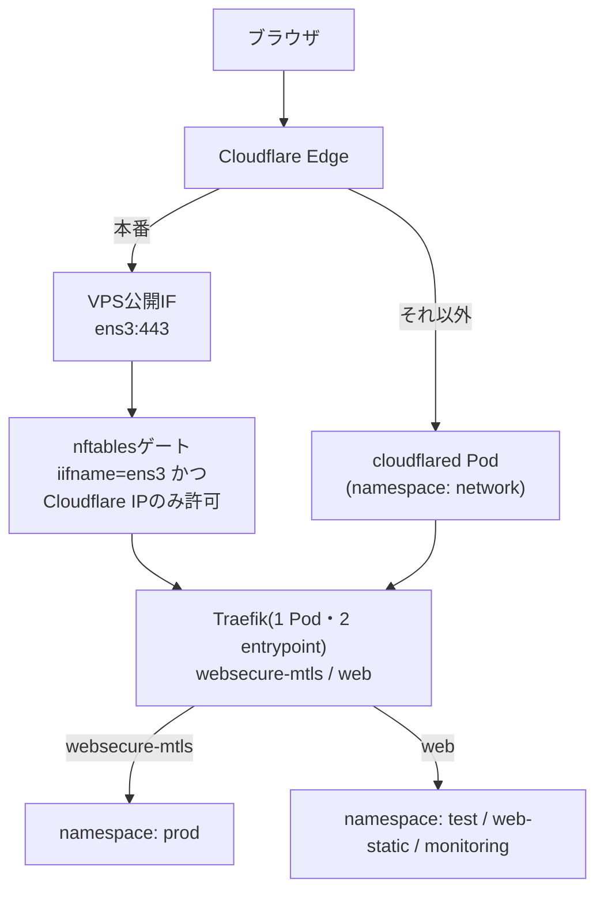
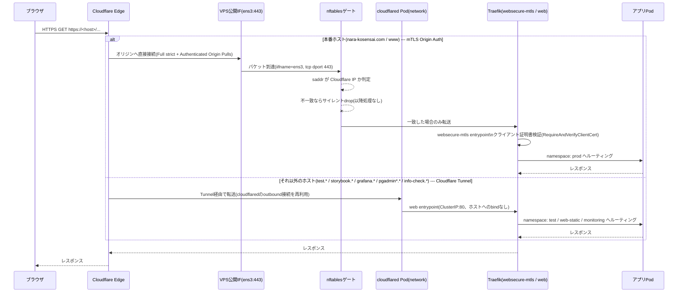

# nara-kosensai システム構成・仕様書

対象リポジトリ: `nara-kosensai/manifest`(旧 `config`)、`fumikun/2026kosensai`
最終更新: 2026-08-29

> この文書は [architecture.typ](architecture.typ) / [architecture.pdf](architecture.pdf) のMarkdown版。
> 内容はTypst版と同期させること。図表を含む正式な整形版はPDFを参照。

## 目次

- [概要](#概要)
- [アーキテクチャ](#アーキテクチャ)
  - [リクエスト経路](#リクエスト経路)
  - [namespace構成](#namespace構成)
- [ネットワーク・セキュリティ](#ネットワークセキュリティ)
  - [公開ポート](#公開ポート)
  - [TLS / mTLS](#tls--mtls)
  - [展示用PC向けホスト](#展示用pc向けホスト)
  - [RBAC](#rbac)
- [シークレット管理](#シークレット管理)
- [CI/CDパイプライン](#cicdパイプライン)
- [監視](#監視)
- [障害と設計判断](#障害と設計判断)
- [リファレンス](#リファレンス)

## 概要

nara-kosensaiは、単一VPS上のシングルノードk3sクラスタで運用されている。旧構成(VPSネイティブのnginx
と複数のdocker-compose)から全面移行したもので、外部通信は原則Cloudflare Tunnel経由のみとし、クラス
タはノードの公開インターフェースに極力ポートをバインドしない。唯一の例外が本番アプリ
(`nara-kosensai.com` / `www.nara-kosensai.com`)で、CloudflareのOrigin
Authentication(mTLS)を使い、Tunnelを経由せず直接オリジンに到達させる。

このクラスタの**k8sマニフェストはすべて本リポジトリ(`nara-kosensai/manifest`)に集約する**
方針である(ディレクトリ構造は[traPtitech/manifest](https://github.com/traPtitech/manifest)を
参考にしたサービス単位のトップレベルディレクトリ構成)。アプリ/コンテンツ固有のコード
(Dockerfile・アプリ本体のソース)だけそれぞれのサービスのリポジトリに置く。

| リポジトリ | 内容 |
| --- | --- |
| `nara-kosensai/manifest`(本リポジトリ) | 全k8sマニフェスト(クラスタブートストラップ`k3s/`、ArgoCD本体`argocd/`、Application定義`applications/`、共有プラットフォーム設定`network/`・`monitoring/`・`pgadmin/`・`web-static/`、アプリ本体`app-{prod,test}/`、website`website-{prod,test}/`)、この仕様書。CIは`main`ブランチへのpushで発火 |
| `fumikun/2026kosensai` | 当年アプリ本体(backend/frontend/db/website)のDockerfile・CI/CD。CIはイメージをbuild/pushした後、本リポジトリの`app-{prod,test}/`・`website-{prod,test}/`のイメージタグを更新してcommit&push |
| `fumikun/hr` | シフト調整システム本体のDockerfile・CI。CIはイメージをbuild/pushした後、本リポジトリの`hr/kustomization.yaml`のイメージタグを更新してcommit&push |
| `nara-kosensai/www` | 過去年度(2009-2016, 2017-2025, 2021)アーカイブサイトの中身と、そのイメージをビルドするDockerfile・CI。旧年度(2009-2016, 2021)は`scripts/download-old-years.sh`で学校公式サイトから取得・UTF-8変換したもの。デプロイ先マニフェスト(`web-static/archive-*.yaml`)は本リポジトリ側が保持する |
| `fumikun/kosensai-form-preview` | 高専祭掲載情報プレビューツール本体・CI。デプロイ先マニフェストは本リポジトリ側(`web-static/form-preview-*.yaml`) |

*(表: 設定リポジトリの役割分担)*

> **2026-09時点の変更**: 以前は「共有プラットフォーム設定は`manifest`、アプリ/website固有の
> k8sマニフェストは`2026kosensai`リポジトリの`infra/k8s/`」という分散管理方針を採っていたが、
> 管理対象リポジトリを減らし`kubectl kustomize`によるローカル検証・ArgoCDのDeploy Key管理を
> 単純化するため、全マニフェストを本リポジトリに集約した。あわせて自己ホストInfisicalの
> 残骸(`infisical/docker-compose.prod.yml`、Infisicalは2026-08-29付けで廃止済み)も削除した。

> **リポジトリ名について**：本リポジトリはGitHub上で`nara-kosensai/config`から`nara-kosensai/manifest`へリネーム済み(2026年)。リネーム後もGitHubは旧URL(`.../config.git`)から新URLへの参照を自動転送するため、旧URLを`origin`に設定した既存クローンはfetch/pushとも動作し続けるが、新規クローンやCIの`checkout`アクションは新URL(`nara-kosensai/manifest`)を使うのが望ましい。ドキュメント内では現在の正式名`manifest`を主に用い、旧名`config`は文脈上必要な場合のみ併記する。

## アーキテクチャ

### リクエスト経路

外部からのリクエストは、宛先ホストによって2つの異なる経路のいずれかを通る。両方とも最終的に同一の
Traefik Pod(namespace: `kube-system`)へ到達するが、Traefikの中では別々のentrypointとして扱わ
れ、互いに干渉しない。



*(図: 本番(mTLS Origin Auth)とそれ以外(Cloudflare Tunnel)、2つの入口経路)*

上図の通り、`websecure-mtls`だけがホストポートに紐づいたentrypointであり、`web`にはホストへの
bindが一切ない。したがって`web`側に残されたIngressRouteは、たとえnftablesのフィルタやクライアン
ト証明書の検証が何らかの理由で回避されたとしても、インターネットからは構造的に到達不可能である
([障害と設計判断](#障害と設計判断)も参照)。

| 段階 | 本番 --- mTLS Origin Auth | それ以外 --- Cloudflare Tunnel |
| --- | --- | --- |
| 対象ホスト | `nara-kosensai.com` / `www.nara-kosensai.com` | `test.*` / `storybook.*` / `grafana.*` / `pgadmin*.*` / `info-check.*` |
| Cloudflareエッジ | SSL/TLS: Full (strict) + Authenticated Origin Pulls | Cloudflare Tunnel(通常のDNS/SSLモード設定とは独立に動作) |
| VPSへの入口 | 公開インターフェース `ens3:443`(hostPort) | `cloudflared` Pod(namespace: `network`)、VPS側からのoutbound接続のみ |
| フィルタ | nftables raw prerouting： `iifname == ens3` かつ `tcp dport 443` かつ `saddr ∉ Cloudflare IP` → drop(無応答) | 該当なし(公開ポートを一切持たないため到達手段自体が存在しない) |
| Traefik entrypoint | `websecure-mtls` ・hostPort 443 ・サーバ証明書はOrigin CA証明書 ・`TLSOption`(`RequireAndVerifyClientCert`)でクライアント証明書を検証 | `web` ・ClusterIP :80のみ ・ホストへのbindなし |
| 到達先 namespace | `prod` | `test` / `web-static` / `monitoring` |

*(表: 2つの入口経路の対比)*

上記2経路を時系列で見たシーケンス図は以下の通り。



*(図: リクエスト処理のシーケンス。nftablesで弾かれた場合はTraefikに到達する前に無応答でdropされる点に注意)*

```nft
table ip cloudflare_mtls {
  set cf_ipv4 { type ipv4_addr; flags interval; elements = { ... } }
  chain prerouting {
    type filter hook prerouting priority raw; policy accept;
    iifname "ens3" tcp dport 443 ip saddr != @cf_ipv4 drop
  }
}
table ip6 cloudflare_mtls6 {
  set cf_ipv6 { type ipv6_addr; flags interval; elements = { ... } }
  chain prerouting {
    type filter hook prerouting priority raw; policy accept;
    iifname "ens3" tcp dport 443 ip6 saddr != @cf_ipv6 drop
  }
}
```

*(ソースコード: Cloudflare IP allowlist(nftables、`k3s/cloudflare-ip-allowlist.sh`が生成。IPv4/IPv6で独立したテーブルを持つ))*

`cloudflare-ip-allowlist.sh`は冪等な全置換方式で動作する：新レンジ取得 → 一時ファイルに新rulesetを組み立て → 既存の`cloudflare_mtls` / `cloudflare_mtls6`テーブルを削除 → `nft -f`で新rulesetをアトミックに適用、という順序を取る。`curl`でのレンジ取得に失敗した場合は`set -euo pipefail`によりテーブル削除前に異常終了するため、古いルールが残ったフェイルセーフ側に倒れる。一方、テーブル削除後の`nft -f`適用自体が失敗した場合は、次回のtimer実行(最大24時間+ランダム遅延)までdropルールが存在しない期間が生まれうる(既知の課題、[operations.md](operations.md)参照)。

### namespace構成

| namespace | 代表ホスト | 内容 |
| --- | --- | --- |
| `prod` | `nara-kosensai.com` / `www` | frontend・backend・db (StatefulSet)・website・pgadmin |
| `test` | `test.nara-kosensai.com` | frontend・backend・db・website・pgadmin |
| `web-static` | `storybook.*` / `info-check.*` | www-archive(過去年度アーカイブ)・storybook・form-preview |
| `monitoring` | `grafana.nara-kosensai.com` | grafana・loki・prometheus・node-exporter・kube-state-metrics |
| `network` | --- | cloudflared(公開Web用Tunnel) |
| `argocd` | `argocd.nara-kosensai.com` | ArgoCD本体(GitOpsコントローラ) |
| `kube-system` | --- | Traefik(k3s同梱)・CoreDNS |

*(表: namespace一覧)*

`prod`/`test`/`monitoring`/`network`/`web-static`の実際のマニフェストapplyはArgoCD
(namespace: `argocd`)がgitを直接pullして行う。`argocd`自体のインストールと、各namespaceの
作成・Secret投入(ArgoCDの管理対象外)は引き続き各リポジトリのpush-CIが担う
(詳細は[CI/CDパイプライン](#cicdパイプライン)を参照)。
`web-static`/`prod`/`test`のIngressRouteは、過去年度アーカイブ(`web-static` namespace)のService
をcross-namespaceで参照する。単一テナント運用のクラスタであるため、Traefikの
`providers.kubernetesCRD.allowCrossNamespace: true`を有効にしている。

### Ingressルーティング(旧nginxからの移植)

旧構成のnginx `default.conf`のserver blockが持っていたパス単位のルーティング・リダイレクト
ロジックは、TraefikのIngressRoute/Middlewareとして本リポジトリの`app-{prod,test}/ingress-route.yaml`に移植した。nginxのlongest-prefix-wins相当を明示的な
`priority`(数値が大きいほど高優先)で再現している。

| priority | マッチ条件(prod, Host=nara-kosensai.com) | Middleware | 転送先 |
| --- | --- | --- | --- |
| 100 | `Host(www.nara-kosensai.com)` | `www-to-apex`(恒久リダイレクト) | apexへ301 |
| 90 | `Path(/)` / `Path(/2026)` / `Path(/2026/app)` | `redirect-root` 等(末尾`/`付与) | 301 |
| 80 | `PathPrefix(/2026/app/)` | `security-headers` | frontend :3000 |
| 60 | `PathPrefix(/2026/)` | `security-headers`(testのみ`strip-2026-prefix`も併用) | website :80 |
| 50 | `Path(/404)` | `security-headers`, `add-2026-prefix` | website :80(`/2026/404`相当) |
| 10 | `PathPrefix(/)`(catch-all) | `security-headers` | www-archive :80(namespace: web-static) |

*(表: prod IngressRouteのルーティング優先度。testもほぼ同構成、mTLSではなくTunnel経由)*

補足:

- 旧年度(2009-2016, 2021)は以前`old-years-redirect` Middlewareで学校公式サイト(`nara-k.ac.jp`)へ301していたが、`nara-kosensai/www`リポジトリの`scripts/download-old-years.sh`で該当コンテンツをダウンロード・Shift_JIS→UTF-8変換した上で取り込み、2017年度以降と同様にpriority 10の catch-all → `www-archive` で自前配信するよう変更した(専用ルールは廃止)。
- **`strip-2026-prefix`**：当年サイト(Astro)は`base: "/2026"`でビルドされ、生成HTML内のアセット参照は`/2026/...`前提。prodは旧nginxの`alias`相当の動作(内部的にプレフィックス除去)をwebsiteコンテナ側のビルド設定で吸収しているためMiddleware不要だが、testのwebsite Serviceは素のリバースプロキシ転送のため明示的な`StripPrefix`が必要(`app-test/ingress-route.yaml`の`strip-2026-prefix` Middleware)。
- **`/404`ルートと`add-2026-prefix`**：`www-archive`は存在しない年度(例: `/2007/`)へのアクセスに対し、自身のnginx設定(`error_page 404 https://nara-kosensai.com/404;`、`nara-kosensai/www`リポジトリの`nginx-default.conf`)で`https://nara-kosensai.com/404`へ実際の3xxリダイレクトを返す。この`/404`はTraefik側で`add-2026-prefix`(`/404` → `/2026/404`)を経て`website` Serviceへ転送され、当年サイト(Astro)の`404.astro`ビルド結果を返す。以前は`archive-404`(errors Middleware)で`www-archive`自身の`/2025/404.html`をその場で差し込んでいたが(URLは変わらない)、実際のリダイレクトで統一するため廃止した。
- **`security-headers`** Middleware(`ingress/security-headers.yaml`、`2026kosensai`リポジトリにも同一内容を複製配置)は、`X-Frame-Options`, `X-Content-Type-Options`, `Strict-Transport-Security`に加え、Google Tag Manager / Google Fonts / YouTube埋め込みを許可するCSPを全ホスト共通で付与する。
- **pgAdmin**(`pgadmin.nara-kosensai.com` / `pgadmin-test.*`)は`web` entrypointのみを使い(Tunnel経由)、TraefikのMiddlewareではなくCloudflare Access(Tunnelのpublic hostnameに紐づく認証ポリシー、ダッシュボード側で一度きり設定)で保護する。

#### Cloudflare Tunnel側のingress設定

`web`entrypoint行きの全ホストは、`cloudflared`(namespace: `network`)のConfigMap(`network/cloudflared-configmap.yaml`)で一律`http://traefik.kube-system.svc.cluster.local:80`へ転送されるよう設定してあり、ホスト単位の実際の振り分けは前述の各namespaceのIngressRouteに委ねている。Tunnelのingressルールに現れるホストは`test.*`, `storybook.*`, `info-check.*`, `pgadmin.*`, `pgadmin-test.*`, `grafana.*`で、末尾は`service: http_status:404`のcatch-allで閉じる。本番ホスト(`nara-kosensai.com` / `www`)は、Origin Authentication移行が完了した時点でこのConfigMapのingressエントリから削除済み(現在Tunnel経由で到達するのは`test`/`web-static`/`monitoring`配下のホストのみ)。

## ネットワーク・セキュリティ

### 公開ポート

VPSの公開インターフェースにbindされるポートは443/tcpのみ。80/tcpはTraefikの`web`
entrypointがClusterIPのみで待ち受けており、ホストには一切bindされない。

443/tcpへのアクセス制限は、VPSプロバイダ側とホスト側で役割が異なる。

1. **VPSプロバイダのファイアウォール(セキュリティグループ)**：ポート単位の制限のみを行う(443/tcpと管理用SSH以外を閉じる)。送信元IPアドレスによるフィルタリングは行っていない――つまりこの層だけでは、Cloudflare以外の任意のIPから443/tcpへ到達できてしまう。
2. **ホスト側nftables**(`k3s/cloudflare-ip-allowlist.sh`、上記nftルール参照)：送信元IPアドレスのフィルタリングは、この層が唯一かつ全面的に担っている。Cloudflareが公開しているIPv4/IPv6レンジ(`https://www.cloudflare.com/ips-v4`, `ips-v6`)を、raw prerouting段階でパケットの送信元インターフェース(`iifname`、デフォルトルートから動的に解決)と組み合わせて判定する。マッチしない場合はTCPハンドシェイクにもTLSアラートにも至らずサイレントにdropする。IPv4/IPv6それぞれ独立したテーブル(`ip cloudflare_mtls` / `ip6 cloudflare_mtls6`)を持つ。systemd timer(`cloudflare-ip-allowlist.timer`)が日次でレンジを再取得し、`manifest`リポジトリへのpush時にもCIが都度再実行する。

したがって、Cloudflare IPアローリストの実体は完全にnftables側にある。このスクリプトが失敗した状態が長く続くと、VPSプロバイダ側のファイアウォールはそれを補ってくれない(運用マニュアル[operations.md](operations.md)の「1. Cloudflare IPアローリストの更新不具合」を参照)。

### TLS / mTLS

- **オリジンサーバ証明書**：Cloudflare Origin CA証明書。SANは`nara-kosensai.com`と
  `*.nara-kosensai.com`をカバー(有効期限2041年)。`2026kosensai`リポジトリの
  `production-vps` environmentのGitHub Environment Secret(`CF_ORIGIN_CERT` /
  `CF_ORIGIN_KEY`)として保管し、CIが`prod` namespaceに`cloudflare-origin-cert`
  (`kubernetes.io/tls`)Secretとして投入する。
- **クライアント証明書検証**：Traefikの`TLSOption`(namespace: `network`、名前
  `cloudflare-mtls`)が、Cloudflareが公開しているAuthenticated Origin Pulls用CA証明書
  (`network/cloudflare-aop-ca.yaml`、公開情報のためgit管理)に対して
  `RequireAndVerifyClientCert`を要求する。FreeプランのためCloudflare管理のzone-level
  証明書を使用する(per-hostnameのカスタムクライアント証明書は非対応)。

```yaml
spec:
  entryPoints:
    - websecure-mtls
  tls:
    secretName: cloudflare-origin-cert
    options:
      name: cloudflare-mtls
      namespace: network
```

*(ソースコード: prod IngressRouteのTLS設定(`app-prod/ingress-route.yaml`))*

### 展示用PC向けホスト

文化祭の展示用PC(来場者が触れるWindows端末、管理者権限なし)だけから、ArgoCDと
Grafanaを閲覧させるための専用ホスト。既存の`argocd.*` / `grafana.*`(Cloudflare
Access・GitHub OAuthで運用者のみ)とは別ホストにし、運用者向けの認証には手を入れない。

| ホスト | 転送先 | 見せる範囲 |
| --- | --- | --- |
| `exhibit-a.nara-kosensai.com` | `argocd/argocd-server` | 匿名ユーザー=`role:expo`(Application/Projectの閲覧のみ、Podログ不可)。TraefikでGET/HEAD以外をルーティングしない(ログイン・Sync等の操作は不可)。リソースのmanifest・イベントを返すAPIは403 |
| `exhibit-b.nara-kosensai.com` | `monitoring/grafana-expo-proxy` → `grafana` | Grafanaの公開ダッシュボードのみ(`/public-dashboards/`, `/api/public/`, `/public/`以外はTraefikの404)。Grafana本体の匿名アクセスは無効のまま |

*(表: 展示用PC向けホスト)*

**アクセス制御はCloudflareエッジのクライアント証明書(mTLS)で行う。** 本番の
Origin Authentication(Cloudflare→オリジン間)とは逆向きで、ブラウザ→Cloudflare間の
mTLSである。

- `SSL/TLS > Client Certificates`でCloudflare管理CAのクライアント証明書を発行し、
  上記2ホストでmTLSを有効化する。
- WAFカスタムルールで、有効な(失効していない)証明書を提示しないリクエストをBlockする。
- 証明書は展示用PCの「現在のユーザー」証明書ストアに入れる(管理者権限不要、秘密鍵は
  エクスポート不可)。紛失・流出時はダッシュボードから失効させる。

**展示用ホストから管理用ホスト名を推測させない。** 来場者が見るURLや画面から
`argocd.*` / `grafana.*`が分からないよう、次の対策をしている(新しい展示用ホストを
足すときも同じ観点で確認すること)。

- ホスト名は中身と無関係な`exhibit-a` / `exhibit-b`にする(`argocd-expo`のような
  元の名前を含む名前にしない)。
- ArgoCDの`argocd-cm`に`url`を設定しない(`/api/v1/settings`で返ってしまうため。
  SSOは使っておらず、通知のリンクは`argocd-notifications-cm`の`argocdUrl`で別に持つ)。
- ArgoCDのリソース詳細API(`managed-resources` / `resource` / `manifests` / `events`)を
  展示用ホストでは403にする。`cloudflared-config`やIngressRouteのmanifestには全ホスト名が
  書かれているため。
- GrafanaはHTMLに`appUrl`(`GF_SERVER_ROOT_URL`)を埋め込むが、root_urlはGitHub OAuthで
  使うため変えられない。展示用ホストだけnginx(`grafana-expo-proxy`)を挟み、
  レスポンス中の`grafana.nara-kosensai.com`を`exhibit-b.nara-kosensai.com`に置換する。
- 公開ダッシュボードの中身(パネルのクエリ結果)に管理用ホスト名が出ないものだけを
  公開する(例: Traefikのルーター名やアクセスログのHostラベルを表示するパネルは避ける)。

ただし画面を見ればArgoCD/Grafanaであることは分かるので、「argocd.」「grafana.」を
当てずっぽうで試されることまでは防げない。管理用ホストはこれまで通りCloudflare
Access / GitHub OAuthで守られている前提である。

VPS側で直接クライアント証明書を検証する構成(nginx等)は採らない: 443/tcpは
Cloudflare IPレンジ以外をnftablesでdropしており(上記「公開ポート」)、`web`
entrypointはTunnel経由でTLSがCloudflareで終端済みのため、オリジンでは展示用PCの
証明書を見られないため。Cloudflare Accessのmutual TLSルールもプランの制約があるため
使わない。

### RBAC

Prometheusとkube-state-metricsは、それぞれ専用のServiceAccountで動作し、read-onlyの
`get`/`list`/`watch`のみを許可するClusterRoleを持つ(`monitoring/prometheus-rbac.yaml`、
`kube-state-metrics.yaml`)。既定のServiceAccountには何の権限も付与しない。

kube-state-metrics用ClusterRoleは`list`/`watch`のみだが、対象リソースには`secrets`が含まれる(Secret自体の値ではなく、存在・メタデータを可視化するため標準的に必要とされる範囲)。書き込み権限は一切付与していない。Prometheus用ClusterRoleはノード・Pod・Service・Endpointsの`get`/`list`/`watch`に加え、kube-apiserver/kubelet/cAdvisorのメトリクスエンドポイントにアクセスするためServiceAccountトークンをbearer tokenとして使う(`kubernetes_sd_configs`によるin-cluster discovery、TLS検証は`kubelet`ジョブのみ`insecure_skip_verify: true`で緩めている。単一ノード・単一テナント運用のため許容)。

## シークレット管理

Infisical(自己ホスト)は2026-08-29付けで完全に廃止した。現在の方針を以下に示す。

| 対象 | 保管場所 | 理由 |
| --- | --- | --- |
| DB / pgAdmin / CORS等 (`app-env`) | `manifest`リポジトリ直下の `prod.env` / `staging.env`(平文コミット) | DBはClusterIP限定で外部到達不能 |
| GHCR pullトークン | GitHub Environment Secret(`production-vps` / `test-vps`) | CIからのみ必要 |
| Cloudflare Origin CA証明書 | GitHub Environment Secret(`production-vps`、環境限定) | 本番専用の機微情報 |
| Cloudflare Access クライアント資格情報 | GitHub Actions Secret(管理用SSH Tunnel専用) | app-envとは無関係 |
| Grafana管理者パスワード等 | k8s Secret(`grafana-secrets`)ブートストラップ時に手動投入 | gitignore対象、循環依存を避けるため |
| Cloudflare Tunnel(公開Web用)資格情報 | k8s Secret(`cloudflared-credentials`、namespace: `network`)ブートストラップ時に手動投入 | `cloudflared tunnel create`で生成される`credentials.json`はCLI操作でのみ得られる |
| GHCR pullトークン(`web-static` namespace用) | k8s Secret(`ghcr-pull`)ブートストラップ時に手動投入 | `www-archive`/`storybook`/`form-preview`イメージがprivateなため |
| ArgoCD用GitHub Deploy Key(`manifest`/`2026kosensai`各リポジトリ) | k8s Secret(`argocd`namespace、`argocd.argoproj.io/secret-type: repository`ラベル)ブートストラップ時に手動投入 | ArgoCDがprivateリポジトリを読み取り専用でpullするため |

*(表: シークレットの保管場所と方針)*

`manifest`リポジトリのCIが`prod.env` / `staging.env`をVPSの`/home/github/app-env/`に同期
し、`2026kosensai`リポジトリのCIがそのパスを直接`--from-env-file`で参照する。このため
`manifest`側のCIが`2026kosensai`側より先に一度動いている必要がある。同様に、`web-static` namespaceの`ghcr-pull` Secretは、ArgoCDが適用する`web-static/`がDeploymentを作成する前提として存在している必要があり、これも一度きりの手動投入である。

`prod`/`test` namespaceの`ghcr-pull`(2026kosensaiアプリのイメージpull用)は`2026kosensai`リポジトリのCI自身が、GitHub Environment Secret(`GHCR_PULL_TOKEN`)からデプロイの都度`kubectl create secret ... --dry-run=client -o yaml | kubectl apply -f -`で再生成する(こちらは一度きりの手動投入ではなくCI管理)。トークン期限切れ時の症状・対処は[operations.md](operations.md)の「3. GHCR pullトークンの期限切れ・権限エラー(403)」を参照。

## CI/CDパイプライン

2026年9月にpush型(CIが直接`kubectl apply`)からArgoCDによるpull型GitOpsへ移行した。
マニフェスト本体のapplyはすべてArgoCDが担い、各リポジトリのpush-CIは「ArgoCDのスコープ外の
もの(ArgoCD自体のインストール、namespace作成、Secret投入)の同期」と「イメージbuild/push +
マニフェストのイメージタグ更新をgitにcommit&push」だけを行う。

| リポジトリ / ブランチ | 処理内容 |
| --- | --- |
| `manifest` → `main` | k3sブートストラップマニフェスト再配置 → Cloudflare IP allowlist再実行 → app-env(`prod.env`/`staging.env`)をVPSへ同期 → 全マニフェストをVPSへrsync(ArgoCDが直接gitからpullするためapplyはしない、参考用の配置)→ ArgoCD自体を`kubectl apply -k argocd` |
| `2026kosensai` → `main` | イメージbuild/push → `manifest`リポジトリの`app-{prod,test}/`・`website-{prod,test}/`を`kustomize edit set image`でタグ更新 → **`manifest`リポジトリにcommit&push** → namespace作成・GHCR pullトークン/Origin CA証明書由来のSecret投入(VPSへSSH) |

*(表: CI/CDパイプライン一覧)*

ArgoCD(namespace: `argocd`、`argocd.nara-kosensai.com`でCloudflare Tunnel + Access経由公開)は
`manifest`リポジトリの`applications/`が定義するApplication(App-of-apps、`root-app`)を
通じて、すべて同一リポジトリ(`manifest`)の以下パスをgitから直接pullし`automated`
(prune+selfHeal)でsyncする。

| Application | path | 対象 |
| --- | --- | --- |
| `network` | `network/` | cloudflared |
| `monitoring` | `monitoring/` | Grafana/Loki/Prometheus/node-exporter/kube-state-metrics |
| `pgadmin` | `pgadmin/` | 統合pgAdminインスタンス |
| `hr` | `hr/` | シフト調整システム(`fumikun/hr`)のapp + PostgreSQL。`hr.nara-kosensai.com`(Tunnel経由) |
| `web-static` | `web-static/` | www-archive/storybook/form-preview |
| `app-prod` / `app-test` | `app-prod/` / `app-test/` | backend/frontend/db、当該namespaceのIngressRoute/Middleware |
| `website-prod` / `website-test` | `website-prod/` / `website-test/` | website |

`manifest`リポジトリのみがArgoCDの読み取り対象のため、Deploy Keyも`manifest`用の1つのみで
よい(`argocd`namespace内に`argocd.argoproj.io/secret-type: repository`ラベル付きSecretとして
登録、[bootstrap.md](bootstrap.md)参照)。`2026kosensai`/`www`リポジトリはArgoCDから直接
読み取られることはなく、CIが`manifest`リポジトリへ書き込みアクセス(別のDeploy Key/PAT)で
イメージタグ更新をpushするのみ。
CIは`git push`後のArgoCDの実際のsync/rollout成否を待たない点に注意
(現状はArgoCD UI/通知で監視する運用、CI失敗としては検知しない)。

いずれもGitHub ActionsからVPSへは、管理用のCloudflare Access Tunnel(`cloudflared access tcp`)
経由でSSH接続する。これは公開Web用のTunnel(namespace `network`のcloudflared)とは別物で、VPS
側からのoutbound接続であるため、[公開ポート](#公開ポート)のnftables allowlistとは無関係に動作する。

## 監視

Prometheus(namespace `monitoring`)は次をスクレイプする。

- `node-exporter`：ノードのCPU/メモリ/ディスク
- `traefik`：Traefik自身のメトリクス(現状9100番ポートが未公開のため要修正、既知の課題)
- `kube-state-metrics`：Pod/Deployment/StatefulSetのオブジェクト状態(Running/Restart回数/Readyレプリカ数)
- `kubernetes-apiservers`：kube-apiserverのリクエストレイテンシ・エラー率
- `kubelet` / `kubernetes-cadvisor`：ノード・Pod単位のリソース使用量

いずれも`kubernetes_sd_configs`によるin-cluster discoveryと、ServiceAccountトークン
(`/var/run/secrets/kubernetes.io/serviceaccount/`)による認証を使う標準的な構成。Grafanaの
Prometheus/Lokiデータソースは自動プロビジョニングしておらず、初回のみ手動追加が必要
(`http://prometheus:9090`, `http://loki:3100`、いずれも`monitoring` namespace内)。ログは
Grafana Alloy(DaemonSet、`k3s/alloy-logging.yaml`)が全namespaceのPodログをLokiへ出荷する。

## 障害と設計判断

### nftablesルールのインターフェーススコープ(2026-08-29)

Origin Authentication導入時に追加したnftablesルールが、当初`tcp dport 443`のみで判定してお
り、送信元インターフェースを指定していなかった。クラスタ内部には`kubernetes.default.svc`
(ClusterIP、`10.43.0.1:443`)を含む複数のClusterIPがたまたま443番を使っており、このルールは
Pod→APIサーバー間の内部通信まで巻き込んでdropしてしまった。

結果として`helm-install-traefik`ジョブ(Traefikの新しいエントリーポイント設定を適用するための
Helmインストール)がAPIサーバーに到達できず、インストール失敗→アンインストール→再インストール
のクラッシュループに陥り、Traefik自体が消滅。本番環境が約1時間ダウンした(Cloudflareエラー
521/526)。

**対処**：ルールを`iifname`(ノードの実際の外部NIC。ハードコードではなく`ip route show default`
から都度動的に解決)でスコープした。クラスタ内部のトラフィックは定義上この物理インターフェース
を通らないため、どのClusterIPが443番を使っていても衝突しない。

同時に、Traefikのコンテナポート・Service公開ポートでも類似の衝突が発生していた
(`websecure-mtls`をchartのデフォルト`websecure`と同じ8443番/443番で定義していたため)。コンテ
ナポートは8444番、Service公開は`expose.default: false`(hostPortのみ、Service経由の公開はそも
そも不要)に変更して解消した。

### push型CIからArgoCD(GitOps)への移行(2026-09-02)

デプロイをCIから直接`kubectl apply`するpush型から、ArgoCDがgitを直接pullしてapplyするpull型
(GitOps)へ移行した。狙いは主に2点: (1) VPS上の実際の状態とgitの内容が乖離した場合に
`selfHeal`で自動的に検知・是正できるようにする、(2) 各リポジトリのCIから
`rsync`+`kubectl apply`+複数の`rollout status`待ちという長い手続きを排除し、CIの責務を
「イメージbuild/push + マニフェストのタグ更新をgitに反映する」ことだけに縮小する。

**ArgoCD自体はGitOps管理の対象外とした**(`argocd/`、push-CIが恒久的に適用)。
理由は、ArgoCDの管理対象にArgoCD自身を含めると、ArgoCDが何らかの理由で壊れた場合に
ArgoCD自身を使った復旧ができなくなるため(chicken-and-egg問題)。これは既存の`k3s/`
ブートストラップ層(k3s本体・Traefik設定など)がpush-CI管理のまま残っている設計判断と同じ理由
による。

Secret類(`app-env`, `ghcr-pull`, `grafana-secrets`, `cloudflared-credentials`,
`cloudflare-origin-cert`)はこれまで通りgitにコミットせずkustomizeの`resources`にも含めない
運用を維持した。ArgoCDの管理対象は各kustomize baseのresourcesに列挙されたものだけなので、
これらのSecretはArgoCDの`selfHeal`によるprune対象にもならず、CIが引き続き
`kubectl create secret ... --dry-run=client -o yaml | kubectl apply -f -`で投入する。

**既知のトレードオフ**: CIは`git push`後、ArgoCDによる実際のsync/rolloutの成否を待たない
(移行前は`kubectl rollout status`でCIジョブ自体が失敗検知していた)。現状はArgoCD UI/通知での
監視に委ねている。将来的に`argocd app wait`をCloudflare Access Tunnel経由でCIから呼ぶ形に
拡張し、CIでの失敗検知を復元する余地がある(未実装)。

## リファレンス

| 項目 | 値 |
| --- | --- |
| Kubernetesディストリビューション | k3s(シングルノード) |
| Ingressコントローラ | Traefik 3.7(k3s同梱Helmチャート) |
| CNI | flannel(k3s標準) |
| ストレージ | local-path(既定)、local-path-retain(データ保護が必要なPVC用) |
| 公開ポート | 443/tcpのみ(80/tcpはClusterIP限定で非公開) |
| Traefik `websecure-mtls` | containerPort 8444, hostPort 443, expose.default: false |
| Traefik `web` | containerPort 8000相当(chart既定), ClusterIP:80のみ |
| 管理用SSH | Cloudflare Access Tunnel(公開Web用Tunnelとは別物、outbound-only) |

*(表: 設定値リファレンス)*

## 付録: 旧nginx構成との対応関係

VPSネイティブのnginx + 複数docker-compose(`nginx.conf` / `default.conf` / `grafana/`)から
k3sへ全面移行した際の対応表。現行の実装は上記各節を参照。

| 旧 (`default.conf`) | 新 |
| --- | --- |
| http-context の `add_header` (CSP等) | `ingress/security-headers.yaml` |
| www→apex, `/`, `/2026`, `/2026/app` リダイレクト | `app-{prod,test}/ingress-route.yaml` |
| `/2026/app/` → `proxy_pass localhost:3000` | `2026kosensai`側 IngressRoute(frontend Service) |
| `/2026/` → `alias .../website/dist/` | 同上(website Service, CIビルドのnginxイメージ) |
| `root /var/www/html/`(過去年度アーカイブ、旧年度2009-2016,2021は`nara-k.ac.jp`への外部リダイレクトだったがコンテンツ取り込み済み) | `web-static/archive-*.yaml`(`nara-kosensai/www`リポジトリ) |
| `/404.html` alias | `www-archive`(`nara-kosensai/www`)のnginx `error_page 404`が`nara-kosensai.com/404`へ301。`/404`は`app-prod/ingress-route.yaml`が`website`(当年サイトの404ページ)へ転送 |
| storybookサーバブロック | `web-static/storybook-route.yaml` |
| `:8080 /metrics` (nginx stub_status) | Traefikの標準Prometheusメトリクス |
| `grafana/docker-compose.yml`(Loki, Grafana, Prometheus, node-exporter, promtail, nginx-exporter) | `monitoring/*`。**promtailとnginx-exporterはnginx retireに伴い廃止**(promtailの役割はGrafana Alloyに、nginx-exporterの役割はTraefikネイティブメトリクスに統合) |
| `infisical/docker-compose.prod.yml` | 廃止([シークレット管理](#シークレット管理)の通り、秘密情報はgitコミットとGitHub Secretsに移行) |
